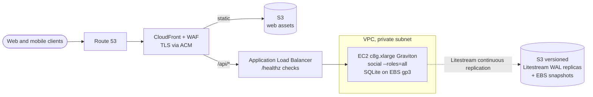
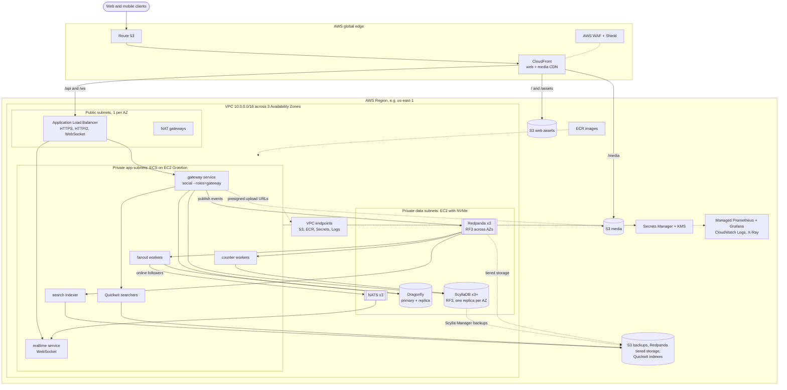
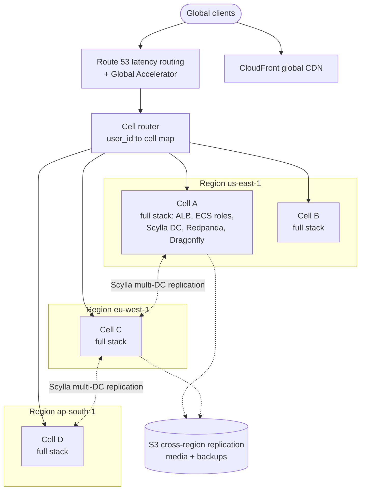
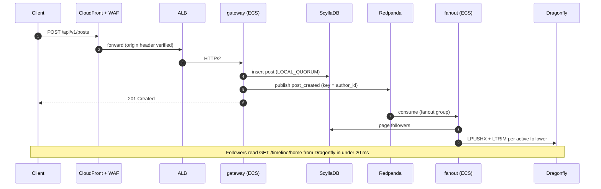
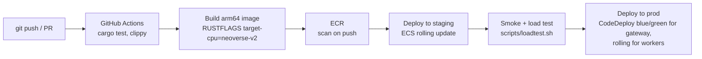

# my_social on AWS: Deployment & Services Plan

Status: **Proposed.** See [ADR 0012](../adr/0012-aws-hosting-option.md). This plan maps
the architecture in `docs/ARCHITECTURE.md` onto AWS, phase by phase. The application
architecture does not change; only where it runs does.

> Prices are rough on-demand estimates for `us-east-1` in USD per month, for comparing
> options. Verify them in the AWS Pricing Calculator before committing. Savings Plans or
> Reserved Instances typically cut compute cost by 30–50%.

---

## 1. Guiding choices

1. **Self-manage the hot data path on EC2; use AWS-managed services for everything
   else.** The stateful systems that decide performance and cost (ScyllaDB, Redpanda,
   Dragonfly) run on EC2 instances with local NVMe. Managed equivalents cost several
   times more at this write volume (§3). Edge, TLS, DNS, object storage, secrets, the
   container registry and observability are AWS-managed.
2. **Graviton (arm64) everywhere.** It typically gives the best price-performance on
   EC2. Build with the right `target-cpu`: `neoverse-v1` for Graviton3, `neoverse-v2`
   for Graviton4 (ADR 0009).
3. **Three Availability Zones, rack-aware data.**
   - The data stores use RF3, with one replica per AZ (the AZ acts as the "rack").
   - Clients read from replicas in their own AZ, because **cross-AZ traffic is billed**
     (about $0.01/GB in each direction). At scale this becomes a top-5 cost line if
     ignored.
4. **Infrastructure as code from day one:** Terraform, with one module per tier (§10).
5. **No SSH.** Use SSM Session Manager, IAM roles per workload, KMS encryption
   everywhere.

---

## 2. Service map

| Concern | AWS service / deployment | Notes |
|---|---|---|
| DNS | **Route 53** | Health checks; latency-based routing in Phase 4 |
| TLS certificates | **ACM** | On CloudFront and the ALB |
| CDN, static web | **CloudFront** + **S3** | `web/` assets with long cache TTL |
| L7 protection | **AWS WAF** + **Shield Standard** | Bot control and IP rate rules at the edge. App rate limits remain (SPEC §5) |
| Load balancing | **ALB** | HTTP/2, WebSocket, `/healthz` target health checks |
| App compute | **ECS on EC2** (Graviton `c8g`/`c7g`), capacity providers + Auto Scaling | One container image (`social`), one ECS service per role |
| Primary store | **ScyllaDB on EC2** (`i4i` / `i8g`, NVMe instance store) | Or ScyllaDB Cloud deployed in our AWS account (§3) |
| Timeline cache | **Dragonfly on EC2** (`r8g`/`r7g`) | Primary + replica in different AZs |
| Event log | **Redpanda on EC2** (`im4gn` / `i4i`) | Tiered storage to S3. Amazon MSK is the managed alternative |
| Realtime pub/sub | **NATS on EC2** (small instances) | WebSocket fan-out to online users |
| Search | **Quickwit on ECS**, indexes on **S3** | Quickwit is built to keep its indexes on S3 |
| Media | **S3** + **CloudFront** | Presigned uploads, lifecycle to S3 Intelligent-Tiering |
| Container registry | **ECR** | Image scanning on push |
| Secrets & keys | **Secrets Manager**, **SSM Parameter Store**, **KMS** | Injected as ECS task environment |
| Metrics | **Amazon Managed Service for Prometheus** + **Managed Grafana** | Or self-hosted VictoriaMetrics to save cost |
| Logs | **CloudWatch Logs** (`--log-json` to stdout) | Ship to S3 + Athena for long retention |
| Traces | **ADOT collector** → **X-Ray** | OpenTelemetry |
| Backups / DR | **S3** (versioned, Object Lock), **AWS Backup** | Scylla Manager snapshots, Redpanda tiered storage, cross-region replication |
| Audit & threat detection | **CloudTrail**, **GuardDuty**, **Security Hub** | |
| CI/CD | **GitHub Actions** (OIDC to IAM) → ECR → ECS deployment | Blue/green via CodeDeploy for the gateway |

---

## 3. Managed vs self-managed data tier

| Role | Self-managed on EC2 (recommended) | AWS-managed alternative | Why not managed |
|---|---|---|---|
| Primary store | ScyllaDB | **Amazon Keyspaces** (serverless Cassandra API) or **DynamoDB** | Per-request pricing gets very expensive at billions of writes per day. Keyspaces lacks some Scylla/Cassandra features (e.g. counters). DynamoDB means a different data model and lock-in. Both are fine for a low-traffic Phase 2 if operational simplicity matters most |
| Cache | Dragonfly | **ElastiCache** / **MemoryDB** (Redis/Valkey) | Higher cost per GB of RAM, and single-threaded shards mean more nodes. ElastiCache Valkey is a reasonable Phase 2 shortcut |
| Event log | Redpanda | **Amazon MSK** (Kafka) | Higher broker cost, JVM. The Kafka API is identical, so switching either way is configuration only (ADR 0004) |
| Search | Quickwit | **OpenSearch Service** | Heavy and costly at this volume (ADR 0007) |
| Users/auth (optional) | in Scylla | **Aurora PostgreSQL** | Only if relational features are needed for a subset (ADR 0002) |

**Middle path:** ScyllaDB Cloud and Redpanda Cloud both offer "bring your own cloud"
deployments that run inside our AWS account. We get vendor operations at near
self-managed hardware cost. Evaluate this at Phase 2.

---

## 4. Phase 1 on AWS: single instance (≈ up to 1M users)

The in-process bus requires `--roles=all` in one process (SPEC §10), so Phase 1 is one
instance. It is made resilient with continuous SQLite replication to S3.



| Item | Choice | ≈ $/month |
|---|---|---|
| Compute | 1 × `c8g.xlarge` (4 vCPU, 8 GiB), EBS gp3 100 GB | 110–130 |
| Edge | CloudFront + WAF (basic rules) + Route 53 | 20–60 + traffic |
| ALB | 1 | 20–30 |
| Backups | Litestream → S3, daily EBS snapshot via AWS Backup | < 10 |
| **Total** | | **≈ 170–250 + egress** |

Failure handling: an Auto Scaling group of size 1 replaces a dead instance. On boot,
`litestream restore` pulls the latest database from S3 (recovery point of about 1 s,
recovery time of minutes).

---

## 5. Phase 2–3 on AWS: multi-AZ cluster (≈ 1M–100M users)

### 5.1 Architecture



### 5.2 Network layout

| Subnet tier | CIDR (per AZ ×3) | Contents | Inbound allowed from |
|---|---|---|---|
| Public | 10.0.0.0/22, 10.0.4.0/22, 10.0.8.0/22 | ALB, NAT gateways | CloudFront origin-facing prefix list only (443) |
| Private app | 10.0.32.0/20, 10.0.48.0/20, 10.0.64.0/20 | ECS container instances | ALB security group |
| Private data | 10.0.96.0/21, 10.0.104.0/21, 10.0.112.0/21 | Scylla, Redpanda, Dragonfly, NATS | App security group, on each system's own ports only |

- **Gateway VPC endpoint for S3** and interface endpoints for ECR, Logs and Secrets
  Manager. These keep image pulls and backups off NAT, which saves cost.
- The ALB accepts traffic only from CloudFront, via the managed prefix list
  `com.amazonaws.global.cloudfront.origin-facing` plus a secret origin header checked
  by WAF.

### 5.3 Data tier sizing (Phase 2 starting point)

| System | Instances | Why this type | ≈ $/month (on-demand) |
|---|---|---|---|
| ScyllaDB | 3 × `i4i.2xlarge` (8 vCPU, 64 GiB, 1.875 TB NVMe), one per AZ | Local NVMe is what Scylla is designed for; EBS adds latency | 1,400–1,600 |
| Redpanda | 3 × `im4gn.xlarge` (Graviton, NVMe), one per AZ | NVMe log segments plus tiered storage to S3 | 750–850 |
| Dragonfly | 2 × `r7g.xlarge` (32 GiB) primary + replica, different AZs | RAM-heavy, Graviton | 300–350 |
| NATS | 3 × `t4g.small` | Low resource use | 40–50 |

Local NVMe is lost if an instance stops. Durability therefore comes from **RF3 across
AZs plus S3 backups**, never from the disk itself. That is the standard model for
Scylla and Redpanda.

### 5.4 Application services (ECS)

Every service runs the same `social` image with different `--roles` flags.

| ECS service | Command | Placement | Scales on | Phase 2 start |
|---|---|---|---|---|
| `gateway` | `social --roles=gateway` | ALB target group, spread across AZs | ALB request count per target, CPU | 3 tasks × 2 vCPU |
| `fanout` | `social --roles=fanout` | Spread | Redpanda consumer lag (`fanout` group) | 2 tasks |
| `counters` | `social --roles=counters` | Spread | Consumer lag (`counters` group) | 2 tasks |
| `realtime` | WebSocket gateway (planned) | ALB target group, sticky not required | Open connections | 2 tasks |
| `search-indexer` | Quickwit indexer | Spread | Consumer lag | 1–2 tasks |
| `search` | Quickwit searcher | Spread | Query latency, CPU | 2 tasks |

App tier instances: start with 3 × `c8g.xlarge` (or `c7g`), about $350–400/month, then
let the ECS capacity provider scale.

ECS settings that match the binary:
- `stopTimeout` of 30 s. On SIGTERM the binary stops accepting requests, drains
  workers and flushes counters.
- ALB deregistration delay of 20 s.
- Health check on `GET /healthz`.
- Logs: `--log-json` to the `awslogs` driver.

**Phase 2 total, rough:** about $4–6k/month on-demand before traffic and egress, about
$2.5–4k with Savings Plans.

### 5.5 Phase 3 additions
- Separate ECS capacity providers per role, so gateway and workers scale independently.
- Grow Scylla horizontally (6–12+ nodes, `i4i.4xlarge` or larger, or `i8g`).
- Add Dragonfly shards, keyed by `user_id`.
- Enable WAF Bot Control and Shield Advanced if the platform becomes a target.
- Consider **EC2 metal instances** (e.g. `i4i.metal`, `c7g.metal`) for Scylla and hot
  services. This brings the bare-metal benefits of ADR 0008 inside AWS.

---

## 6. Phase 4 on AWS: multi-region cells (Twitter scale)



- **Cells:** users are hashed to a home cell, and each cell is a complete stack.
  Capacity grows by adding cells, and a failure is contained to one cell.
- **Cross-cell reads** (following someone in another cell) go through Scylla multi-DC
  replication, with `LOCAL_QUORUM` per region.
- **Data residency:** pin cells to regions as required by law.

---

## 7. Request and event flow on AWS



---

## 8. CI/CD



- GitHub authenticates to AWS with OIDC (no long-lived AWS keys).
- Use multi-stage Docker builds: `rust:<pinned>` builder, then a distroless or
  `scratch` runtime image of about 10 MB.
- Use PGO builds once production profiles exist (ADR 0009).

---

## 9. Security baseline

- Separate AWS accounts for `prod`, `staging` and `shared` (ECR, logging), under AWS
  Organizations with SCP guardrails.
- One IAM task role per ECS service, with least privilege (the gateway can presign S3
  uploads; workers cannot).
- KMS encryption for EBS, S3, Secrets Manager and CloudWatch Logs. TLS between all
  tiers (Scylla, Redpanda and NATS support TLS).
- CloudTrail (organization-wide), GuardDuty, Security Hub, AWS Config.
- No public IPs on app or data instances. Admin access only through SSM Session
  Manager.
- `--secure-cookies` on in every AWS environment.

---

## 10. Infrastructure as code layout (Terraform)

```
infra/
├── modules/
│   ├── network/        VPC, subnets, NAT, endpoints, security groups
│   ├── edge/           Route 53, ACM, CloudFront, WAF, S3 web bucket
│   ├── ecs-cluster/    cluster, capacity providers, ASGs (Graviton)
│   ├── ecs-service/    one per role: task def, service, autoscaling, ALB target group
│   ├── scylla/         EC2 (i4i/i8g), placement per AZ, Scylla Manager, S3 backups
│   ├── redpanda/       EC2 (im4gn), tiered storage bucket
│   ├── dragonfly/      EC2 (r7g/r8g), primary + replica
│   ├── nats/
│   ├── observability/  AMP, AMG, log groups, ADOT
│   └── security/       KMS keys, GuardDuty, CloudTrail, IAM roles
└── envs/
    ├── phase1/         single-instance stack (§4)
    ├── staging/
    └── prod/
```

Configuration of stateful nodes (Scylla, Redpanda, Dragonfly) is done with Ansible or
baked AMIs (Packer), the same playbooks as bare metal. That keeps the AWS and
bare-metal options interchangeable.

---

## 11. Code changes required before deploying on AWS

| # | Change | Why | Phase |
|---|---|---|---|
| 1 | **Configurable trusted proxy hops** (`--trusted-proxy-hops N`), or reading `CloudFront-Viewer-Address` | Behind CloudFront plus ALB, the *last* `X-Forwarded-For` entry is CloudFront's IP, not the client's. The current `--trust-proxy` would rate-limit CloudFront edges instead of users | 1 |
| 2 | Litestream sidecar or entrypoint + `Dockerfile` | Continuous SQLite backup to S3 | 1 |
| 3 | `storage-scylla`, `cache-dragonfly`, `events-redpanda` implementations | Separate roles need a shared bus, store and cache | 2 |
| 4 | **Snowflake worker-ID leasing** (e.g. a lease row with TTL in Scylla or Dragonfly) | ECS tasks are ephemeral, so static `--worker-id` values can collide | 2 |
| 5 | Prometheus `/metrics`, including consumer lag | ECS autoscaling and dashboards | 2 |
| 6 | Presigned S3 upload endpoint | Media | 2 |
| 7 | Readiness check separate from liveness (`/readyz` checks dependencies) | Avoid sending traffic to tasks whose backends are unreachable | 2 |

---

## 12. AWS vs bare metal: cost comparison

| | AWS (this plan) | Rented bare metal (ADR 0008) |
|---|---|---|
| Phase 1 | ≈ $170–250/mo | ≈ $60–150/mo |
| Phase 2 | ≈ $2.5–6k/mo + egress | ≈ $1–2k/mo, egress usually bundled |
| Egress | $0.05–0.09/GB (CloudFront cheaper at volume) | Often included or a flat rate |
| Ops effort | Lower (managed edge, ALB, S3, IAM, multi-AZ in minutes) | Higher (hardware, network, failover are ours) |
| Elasticity | Minutes | Days |
| Global footprint | 30+ regions | Provider-dependent |

**Recommendation:**
- Use AWS when speed of setup, elasticity, global reach or compliance matter more than
  unit cost.
- At sustained high volume, compare against bare metal (or EC2 metal instances plus
  Savings Plans).
- The architecture is identical on both, so the choice stays reversible.
